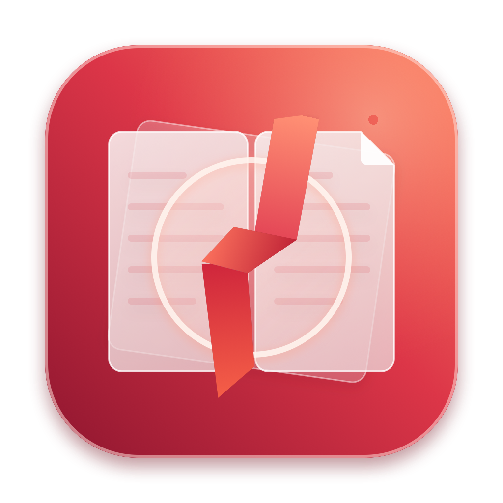

<p align="center">
  
</p>

<h1 align="center">SimplePDFReader — macOS 原生极简 PDF 阅读器</h1>

<p align="center">
  基于 <b>Swift + SwiftUI + 原生 PDFKit</b> 开发的轻量级 macOS PDF 阅读器。<br/>
  专注纯粹阅读体验，仅保留放大缩小、多窗口对比、多屏/自适应分屏、目录大纲、随输随搜与页码跳转等核心高频功能。
</p>

## 核心特性

- **纯净无打扰默认界面**：启动后进入**单屏无侧边栏**的空白状态，窗口里不会自动打开任何文件 —— 打开什么完全由你自己决定；打开 PDF 后同样默认进入单屏无侧边栏模式，将 100% 窗口面积留给文档正文；侧边栏仅在点击左上角「侧栏」按钮时按需展开。
- **精准缩放与实时百分比**：支持工具栏放大/缩小按钮（按 `15%` 步进）与触控板双指捏合缩放，实时同步当前缩放比例（如 `100% → 115% → 130%`），点击百分比数字即可一键恢复 `100%` 原始比例。
- **弹出式多屏与智能自适应菜单**：
  - **单屏 / 双屏 / 三屏 / 四屏（2×2 网格）**：支持同一个 PDF 的多屏跨页对照阅读（如左屏看正文、右屏看图表或参考文献），也支持在副屏点击「换文件」独立打开另一份对比 PDF，或开启「多屏联动顺延翻页」。
  - **自适应分屏（按缩放等级智能判断）**：开启后可根据当前缩放比例自动切换布局——放大（`≥ 115%`）自动切为单屏单页精读、中等缩放（`72% ~ 114%`）自动切为双屏对照、缩小（`< 72%`）自动切为三屏双页概览，并提供 3 种细分策略可选。
- **目录大纲与快速页码导航**：自动递归解析 PDF 内置多级 `PDFOutline` 树并展示对应页码，点击即跳；若 PDF 未包含内置目录大纲，自动降级生成全文档快速页码列表。
- **随输随搜（实时全文检索）**：在搜索框输入字符时自动触发 `80ms` 轻量防抖实时检索，即时高亮全文档匹配项并定位至首处匹配；在搜索框内按回车键（`Return`）直接循环跳转下一处匹配；当输入变为 `0` 匹配时自动彻底清除页面高亮图层。
- **三档响应式自适应工具栏**：窗口最小宽度低至 `400pt`，工具栏根据当前窗口宽度自动在「宽屏完整模式」「中屏紧凑图标模式」与「窄窗双行抽屉搜索模式」之间平滑切换，把窗口缩窄贴在屏幕一侧伴读时也不会出现按钮溢出或裁切。
- **一键设为系统默认阅读器**：在系统顶部菜单栏「SimplePDFReader → 设为默认 PDF 阅读器…」或「文件 → 设为默认 PDF 阅读器…」中即可一键绑定为系统默认 `.pdf` 打开应用。**初次启动时**主窗口就绪后会依次询问两件事（各自终身只问一次）：①「是否将 SimplePDFReader 设为默认 PDF 阅读器？」；②「习惯使用哪种窗口模式？」——之后都不再打扰。
- **多窗口并行，互不干扰**：可同时打开多个窗口（`⌘N` 新建窗口），把两份文档并排比对，无需多显示器。**缩放、翻页、侧边栏、分屏布局、搜索状态全部只作用于当前激活窗口**，另一窗口完全不受影响 —— 每个窗口持有独立状态，操作绝不串台。
  - **打开文件永不顶掉当前内容**：从 Finder 双击 `.pdf`、拖到 Dock 图标、工具栏「打开」按钮、菜单「打开 PDF…」——四处行为完全一致：该文件**没开着**就按需**新开一个窗口**放它；**已经开着**（含作为某个分屏的对比文档）则直接聚焦那个窗口，不重复打开。因此可以一边看 A、一边双击 B 做比对。
  - **内容区右上角「关闭本文档」按钮**：只关掉本窗口的文档、窗口留着回到空白状态，随时可再拖一份进来；**其他窗口完全不受影响**。（窗口左上角的系统红点关的才是窗口本身。）
- **单窗口 / 多窗口模式**：顶部菜单栏新增顶级菜单「**窗口模式**」（位于「编辑」右侧），下面两项「多窗口 / 单窗口模式」当前生效者**带勾**，点另一项即切换。两种模式覆盖不同的使用习惯：
  - **多窗口模式（默认）**：即上一条描述的行为 —— 每个还没打开过的 PDF 都会各开一个新窗口，适合并排比对。
  - **单窗口模式**：全局只保留一个窗口，模仿早期版本的极简行为 —— 无论双击 PDF、工具栏打开还是菜单打开，都只往那唯一的窗口里填（空窗就填入、有内容就替换），**绝不新开窗口**；此时 `⌘N` 也只是把已有窗口提到最前。
  - **从多窗口切到单窗口时**会先弹窗确认：「仅保留本窗口，其他窗口关闭并切换到单窗口模式」——由当前窗口发起切换，该窗口会被保留，其余窗口全部关闭；点「取消」则什么都不发生。从单窗口切回多窗口则立即生效、无需确认。模式选择会记忆，下次启动仍然有效。
  - **窗口标题实时显示当前模式**：空白窗口标题为「SimplePDFReader（多窗口）」，打开文档后为「文件名（多窗口）」；切换模式时所有窗口标题立即同步刷新，与实际模式始终一致。
- **启动即空白，打开什么由你决定**：应用启动后永远只呈现一个空白主窗口，不会自动恢复上次打开的文档。想打开什么，双击文件、拖到 Dock、或点工具栏「打开」都可以。
- **应用内署名「关于」面板**：菜单栏「SimplePDFReader → 关于 SimplePDFReader」打开应用自绘面板，集中展示应用图标、版本号、作者与仓库链接，并提供「复制仓库地址」与「在 GitHub 上查看」快捷按钮。

## 快捷键一览

> 下表除「新建窗口」外，所有快捷键都**只作用于当前激活窗口**；开多个窗口时，不会影响其它窗口。
>
> 另外，把 `.pdf` **直接拖到某个窗口里**会在这个窗口打开它（拖拽是明确的指向性操作，因此按「替换本窗口文档」处理）；拖到窗口之外、或双击文件，则按上表的「打开文件」规则处理。

| 功能分类 | 操作说明 | 快捷键 |
| :--- | :--- | :--- |
| **新建窗口** | 新建一个空白窗口（仅多窗口模式；单窗口模式下只是激活已有窗口） | `⌘ + N` |
| **打开文件** | 打开 PDF：未打开则新窗口打开，已打开则切到那个窗口，当前窗口空着就地填入（单窗口模式下始终只填那唯一的窗口） | `⌘ + O` |
| **关闭本文档** | 关掉本窗口的文档、窗口留着（不关闭窗口，也不影响其他窗口） | `⌥ + ⌘ + W` |
| **切换窗口模式** | 在「多窗口 / 单窗口模式」间切换（顶级菜单「窗口模式」，当前生效项带勾，无快捷键） | 菜单「窗口模式」 |
| **视图缩放** | 放大 `15%` / 缩小 `15%` | `⌘ + =` / `⌘ + -` |
| **比例重置** | 恢复 `100%` 原始大小 / 自适应当前窗口宽度 | `⌘ + 0` / `⌘ + 9` |
| **侧边栏开关** | 按需显示或隐藏左侧「大纲 / 搜索」侧边栏 | `⌘ + ⇧ + S` |
| **分屏模式切换** | 切换 单屏 / 双屏 / 三屏 / 四屏 / 自适应分屏 | `⌘ + 1` ~ `⌘ + 5` |
| **全文实时搜索** | 聚焦右上角搜索框（输入即实时搜索，回车跳下一项） | `⌘ + F` |
| **搜索结果导航** | 查找下一个匹配项 / 查找上一个匹配项 | `⌘ + G` / `⌘ + ⇧ + G` |
| **页面跳转** | 聚焦页码输入框（输入页码回车跳转） | `⌘ + J` |
| **快速翻页** | 上一页 / 下一页 | `⌘ + ↑` / `⌘ + ↓` |

## 安装与运行指南

> ### 只是想用这个 app？你不需要安装任何开发工具
>
> **无论选哪条路径，都不需要 Xcode，也不需要命令行工具。** 只有想自己改代码的人才需要「方式三」。
>
> - **不想碰终端** → 走「方式一」：浏览器下载，首次打开时去「系统设置 → 隐私与安全性」点一次「仍要打开」。
> - **愿意复制粘贴一条命令** → 走「方式二」：**零弹窗、零安装**，一步到位。
>
> 两条路都能正常使用，区别只是**你更愿意点一次设置，还是更愿意粘贴一次命令**。

三条路径任选其一。「**首次打开是否弹窗**」与「**是否需要装 Xcode**」是两个**互相独立**的代价，别把它们混在一起看：

| 方式 | 需要 Xcode？ | 首次打开弹窗 | 适合谁 |
| :--- | :--- | :--- | :--- |
| **方式一**：浏览器下载 Release 产物 | 不需要 | ⚠️ 需放行一次 | 不想装任何开发工具，能接受点一次「仍要打开」 |
| **方式二**：命令行下载 Release 产物 | 不需要 | ✅ 零弹窗 | 会用终端，想一步到位 |
| **方式三**：从源码一键编译 | 需要（约 1–3 GB） | ✅ 零弹窗 | 想自行审计源码或修改代码 |

> **弹窗到底由什么决定？**
> 由扩展属性 `com.apple.quarantine`（隔离标记）决定：**浏览器下载会自动打上这个标记，`curl` / `git clone` 不会**。
> 而 Gatekeeper 只在文件带该标记时才会在启动时介入检查 —— 所以「浏览器下载」有弹窗，「命令行下载」和「源码编译」都是零弹窗。
> **是否需要 Xcode，则只取决于你是「下载现成产物」还是「自己编译」，与弹窗无关。**

### 方式一：浏览器下载 Release 应用包

1. 前往仓库右侧 **Releases** 页面下载最新的 `SimplePDFReader-macOS-arm64.zip` 并解压。
   > **架构说明**：该产物由 GitHub Actions 在 `macos-15`（Apple Silicon）运行器上构建，**仅支持 Apple Silicon（arm64）机型**。Intel Mac 请改用下方的「方式三」从源码编译。
2. 将解压出的 `SimplePDFReader.app` 拖入 `/Applications`（应用程序）目录或任意位置双击运行。
3. **首次打开安全提示说明**：该产物为本地（ad-hoc）签名、未经 Apple 公证。从网络下载后 macOS 会拦截一次，提示「无法打开，因为 Apple 无法检查其是否包含恶意软件」。放行方式有两种（任选其一）：
   - **系统设置放行**：先在 Finder 里双击一次以触发拦截（保持提示框不要关掉），再打开「系统设置 → 隐私与安全性」，向下滚动到「安全性」，点 **「仍要打开」**，输入登录密码确认。该按钮在被拦截后 **1 小时内**有效；放行后此 App 会被记为安全性例外，之后可正常双击打开。
   - **终端一键解除隔离**：在终端执行以下命令清除下载隔离属性后即可直接双击打开：
     ```bash
     xattr -cr /Applications/SimplePDFReader.app
     ```
   > ⚠️ **macOS 15 Sequoia 及更高版本已移除「按住 Control 点击 → 打开」的绕过方式**，不要再依赖右键放行。

### 方式二：命令行下载 Release 产物（免弹窗，无需 Xcode）

如果你不介意开一次终端，这是**最省事**的路径 —— 既不用装 Xcode，也不会出现任何安全弹窗。

**首次安装**：把下面这一整行复制进「终端」回车即可。

```bash
curl -L -o /tmp/app.zip https://github.com/xitihangto/SimplePDFReader/releases/latest/download/SimplePDFReader-macOS-arm64.zip && unzip -oq /tmp/app.zip -d /tmp/app && mv /tmp/app/SimplePDFReader.app /Applications/ && echo "✅ 已安装到「应用程序」"
```

> 找不到终端？按 `⌘ + 空格` 搜索「终端」，或从「启动台 → 其他 → 终端」打开。

**如果已经装过旧版**，先执行下面这行移除旧版，再跑上面那条命令（否则新版会被塞进旧版的目录里）：

```bash
rm -rf /Applications/SimplePDFReader.app
```

<details>
<summary>等价的分步版本（想知道每一步在做什么可以展开）</summary>

```bash
# 1. 下载最新版 Release 产物（curl 不会打上隔离标记）
curl -L -o /tmp/SimplePDFReader.zip \
  https://github.com/xitihangto/SimplePDFReader/releases/latest/download/SimplePDFReader-macOS-arm64.zip

# 2. 解压
unzip -o /tmp/SimplePDFReader.zip -d /tmp/SimplePDFReader

# 3. 若已安装旧版，先移到废纸篓（避免覆盖时目录嵌套）
mv /Applications/SimplePDFReader.app ~/.Trash/ 2>/dev/null

# 4. 安装到应用程序目录
mv /tmp/SimplePDFReader/SimplePDFReader.app /Applications/
```

</details>

**原理**：`curl` 不像浏览器那样给文件打上 `com.apple.quarantine` 属性，因此 Gatekeeper 在启动时不会介入评估，双击即开。

安装后可自查以下两项：

```bash
codesign --verify --verbose=2 /Applications/SimplePDFReader.app   # 应输出 valid on disk
xattr /Applications/SimplePDFReader.app                           # 不应出现 com.apple.quarantine
```

> **已装过旧版，想更新到最新版？** 推荐直接跑仓库自带的一键更新脚本（下载最新 CI 产物 → 校验签名 → 旧版移废纸篓 → 装进应用程序目录）：
>
> ```bash
> ./update.sh          # 在仓库目录下执行；也可传具体版本，如 ./update.sh v1.6.0
> ```
>
> 或者手动来：先 `rm -rf /Applications/SimplePDFReader.app` 移除旧版，再跑一次上面的安装命令。**不要直接覆盖安装** —— 那样新版会被塞进旧版目录里，出现嵌套。

### 方式三：从源码一键编译（零弹窗，需装 Xcode）

> **为什么本机编译不会被 Gatekeeper 拦截？**
> macOS 的「无法验证开发者」弹窗只会出现在带有 `com.apple.quarantine`（隔离）属性的 App 上，
> 而这个属性是**浏览器和下载工具**在保存文件时打上的。
> 用 `git clone` 取得源码并在本机编译，产出的 `.app` 天然不带隔离属性，
> 因此**不会触发任何安全弹窗**，双击即可运行。

> ⚠️ **务必使用 `git clone`，不要用网页上的「Download ZIP」按钮。**
> 经浏览器下载的 ZIP 会被打上隔离属性，解压后再编译，产出的 `.app` 仍可能弹窗。

#### 操作步骤

```bash
# 0. 准备工具链（已装过可跳过）
#    若报 "You have not agreed to the Xcode license agreements"，执行：
sudo xcodebuild -license accept

# 1. 克隆源码（不要用 Download ZIP）
git clone https://github.com/xitihangto/SimplePDFReader.git
cd SimplePDFReader

# 2. 一键构建（自动编译 + 本地签名）
chmod +x build_app.sh
./build_app.sh

# 3. 安装到应用程序目录
mv ../SimplePDFReader.app /Applications/
```

脚本会自动完成：用 CoreGraphics 渲染 `1024×1024` 高清图标并封装 `AppIcon.icns` → 编译 Swift 源码 → 注入版本号 → 清除扩展属性 → 执行本地（ad-hoc）签名并校验，最后在**仓库的上级目录**生成 `SimplePDFReader.app`。

终端输出 `构建完成（版本 x.y.z，已本地签名并通过校验）` 即为成功。

**版本号**默认自动读取仓库最近的 git tag；也可以手动指定：

```bash
APP_VERSION=1.2.3 ./build_app.sh
```

#### 环境要求

- **系统**：macOS 13.0 或更高，**Apple Silicon（arm64）机型**（`build_app.sh` 目前按 arm64 目标编译，Intel Mac 不适用）。
- **工具链**：Xcode 或 Xcode Command Line Tools 均可，**无需完整 Xcode**。

#### 全新 Mac 从零准备清单

如果目标机器是**刚装好系统、没装过任何开发工具**的新 Mac，按下面顺序操作。全程**不需要** Apple 开发者账号（无需 99 美元/年），也**不需要** GitHub 账号（公开仓库可匿名克隆）。

| 顺序 | 操作 | 说明 |
| :--- | :--- | :--- |
| 1 | 确认机型 | 必须 Apple Silicon（M 系列）。「  → 关于本机」查看「芯片」 |
| 2 | 确认系统 | macOS 13.0 或更高 |
| 3 | 安装命令行工具 | 打开「终端」执行 `xcode-select --install`，在弹窗中点「安装」并同意许可。约 1–3 GB，视网速 5–20 分钟 |
| 4 | 克隆源码 | `git clone https://github.com/xitihangto/SimplePDFReader.git` |
| 5 | 构建 | `cd SimplePDFReader && chmod +x build_app.sh && ./build_app.sh` |
| 6 | 安装 | `mv ../SimplePDFReader.app /Applications/` |

**注意事项**：

- 第 3 步之前 **`git` 命令是不存在的**（`git` 由命令行工具提供）。新 Mac 上直接敲 `git clone` 会弹出「安装命令行工具」的提示框——这是最容易卡住的地方，先装好工具链再往下走。
- 若第 5 步报 `You have not agreed to the Xcode license agreements`，执行 `sudo xcodebuild -license accept`。
- 磁盘预留约 3 GB（命令行工具 + 构建产物）。
- **登录 Apple ID 与构建无关**，登不登都可以。
- **不要**用浏览器「Download ZIP」下载源码，否则产物会带隔离属性。
- 构建完成后若把 `.app` 通过 **AirDrop / 邮件 / 网盘**发给别的 Mac，接收方会被重新打上隔离属性并弹窗——这种情况才需要按「方式一」的步骤放行。

**关于「能不能一次粘贴执行」**：

- **第 3 步必须单独执行，并等待它彻底装完。** `xcode-select --install` 是图形化异步安装——它只负责弹出安装窗口就立刻返回，真正的下载安装（5–20 分钟）在后台进行。如果把它和后面的命令一起粘贴，终端会**立刻**执行 `git clone`，而此时 `git` 尚未安装，必然失败。
- **第 4～6 步可以合并成一条命令，一次粘贴执行**（用 `&&` 串联，任一环节失败会自动中断，不会带着错误继续往下跑）：

```bash
cd ~ && git clone https://github.com/xitihangto/SimplePDFReader.git && cd SimplePDFReader && chmod +x build_app.sh && ./build_app.sh && mv ../SimplePDFReader.app /Applications/ && echo "✅ 已安装到应用程序目录"
```

- 以下几项**必须交互，无法自动化**：命令行工具安装窗口本身、`sudo xcodebuild -license accept`（需要输入登录密码）。

#### 常见问题

| 现象 | 处理方式 |
| :--- | :--- |
| `You have not agreed to the Xcode license agreements` | 执行 `sudo xcodebuild -license accept` |
| `xcode-select: error: no developer tools were found` | 执行 `xcode-select --install` |
| `git: command not found` | 命令行工具尚未安装，执行 `xcode-select --install` |
| 想确认签名是否正确 | `codesign --verify --verbose=2 /Applications/SimplePDFReader.app`，输出 `valid on disk` 与 `satisfies its Designated Requirement` 即正确 |

## 发版流程（维护者）

本项目对外发布的 Release 产物**只允许由 GitHub Actions 构建产生**，以保证任何一个下载到的 `.app` 都能溯源到具体的源码提交，杜绝「来源不明的二进制包」。

### 标准发版步骤

```bash
# 1. 先在 CHANGELOG.md 中新增对应版本的更新段落
# 2. 打 tag 并推送（tag 必须匹配 v* 格式）
git tag v1.0.1
git push --tags

# 3. 等 CI 构建成功、Release 产物就绪后，把本机安装版更新到该产物
./update.sh
```

推送 tag 后，[`.github/workflows/release.yml`](.github/workflows/release.yml) 会自动：

1. 解析 tag 作为版本号，并通过 `APP_VERSION` 注入到 App 的 `Info.plist`；
2. 在 `macos-15`（Apple Silicon）运行器上执行 `./build_app.sh`，**从源码**编译出 `SimplePDFReader.app`；
3. **校验代码签名有效，且 `Info.plist` 中的版本号与 tag 一致**——任一不通过则构建直接失败，不会产出 Release；
4. 打包为 `SimplePDFReader-macOS-arm64.zip`；
5. 以 `CHANGELOG.md` 作为正文创建同名 Release，并附上该产物。

### 手动重跑

进入 **Actions → Build and Release macOS App → Run workflow**，填入要发布的版本号（例如 `v1.0.1`）即可手动触发一次构建发布。该输入为**必填**且必须以 `v` 开头，**没有默认值**——避免手滑把已发布的 Release 改掉。

### 约定

- **禁止**手工上传本地打包的 zip 作为 Release 附件。本地产物无法自证由仓库源码构建，会破坏产物的可溯源性。
- Release 附件的上传者（uploader）应始终为 `github-actions[bot]`，可据此校验产物真伪。
- 发版前请确认 CI 构建通过；构建失败时不要手工补传产物，应先修复源码或工作流。
- **每次发版后必须更新本机安装版**：等 Release 产物就绪后执行 `./update.sh`，把 `/Applications/SimplePDFReader.app` 更新到该产物（下载 → 校验签名 → 旧版移废纸篓 → 安装），保持本机安装版与线上 Release 一致。

## 项目结构

```text
SimplePDFReader/
├── Package.swift                               # Swift Package Manager 配置文件
├── README.md                                   # 项目中文说明文档
├── CHANGELOG.md                                # 版本更新日志
├── AppIcon.png                                 # 1024×1024 高清应用图标预览
├── AppIcon.icns                                # macOS 多分辨率原生图标包
├── generate_icon.swift                         # CoreGraphics 原生矢量图标生成脚本
├── build_app.sh                                # 一键编译与打包 .app 脚本
├── update.sh                                   # 一键更新 /Applications 里的安装版（下载最新 CI 产物）
├── .github/workflows/release.yml               # GitHub Actions 自动构建与发布 Release 工作流
└── Sources/
    └── SimplePDFReader/
        ├── ModelsAndViewModel.swift            # 大纲解析、分屏状态、智能缩放策略与实时搜索核心逻辑
        ├── WindowSupport.swift                 # 多窗口登记表、窗口管理器、文档共享缓存与应用级设置
        └── AppAndViews.swift                   # PDFKit 视图桥接、响应式工具栏、多屏容器与菜单命令
```
